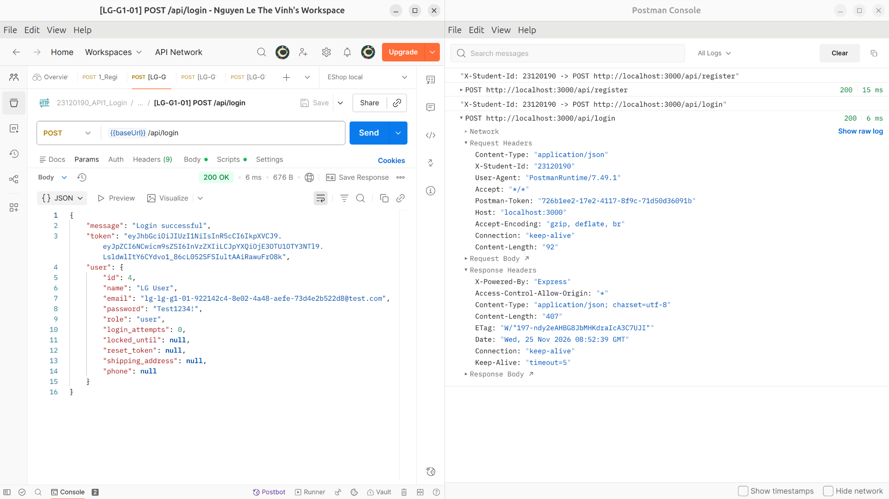
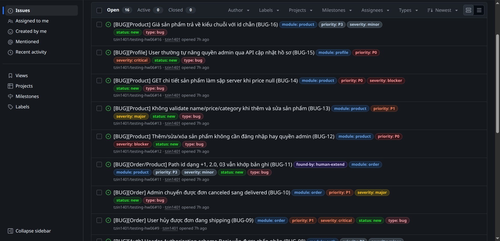
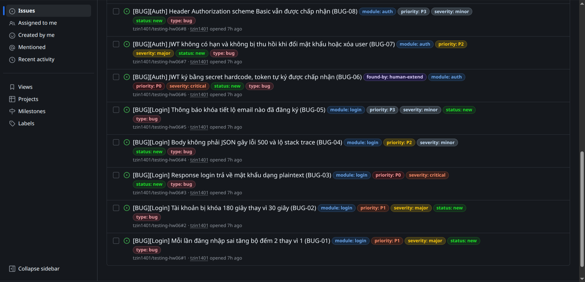
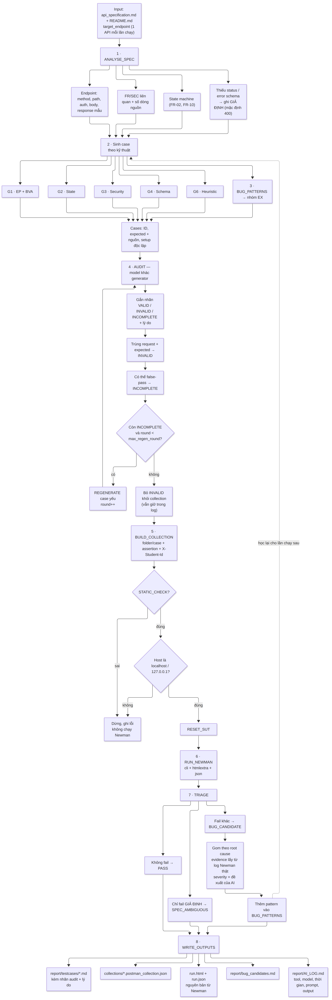

# HW06 – API Testing – Báo cáo chính

| Mục | Nội dung |
|---|---|
| Sinh viên | 23120190 |
| SUT | EShop, [ttbhanh/eshop-sut](https://github.com/ttbhanh/eshop-sut) commit `85af3ba`, chạy tại `http://localhost:3000` |
| Repo bài làm (public) | https://github.com/tzin1401/testing-hw06 |
| Công cụ | Postman Desktop + Newman CLI (`newman-reporter-htmlextra`), GitHub Actions, AI (xem [AI Audit Report](AI_AUDIT_REPORT.md)) |
| Video demo Agent Skill | https://youtu.be/FAk1krlB-ng |

## 1. API đã chọn

Mỗi pool một API, không trùng với thành viên khác trong nhóm ([`TEAM_API_ALLOCATION.md`](../TEAM_API_ALLOCATION.md)).

| # | Pool | Feature | Endpoint | Collection |
|---|---|---|---|---|
| API 1 | A | FR-02 Đăng nhập và khóa tài khoản | `POST /api/login` | [`23120190_API1_Login`](../collections/23120190_API1_Login.postman_collection.json) |
| API 2 | B | FR-10 User hủy đơn (state machine) | `PUT /api/orders/:id/cancel` | [`23120190_API2_CancelOrder`](../collections/23120190_API2_CancelOrder.postman_collection.json) |
| API 3 | C | FR-15 Product CRUD (admin) | `POST/PUT/DELETE /api/products[/:id]` | [`23120190_API3_ProductCRUD`](../collections/23120190_API3_ProductCRUD.postman_collection.json) |

Phân tích spec chung (FR, SEC, state machine, giả định): [`01_spec_analysis.md`](01_spec_analysis.md).

## 2. Quy trình cho mỗi API

Mỗi API đi đúng pipeline **Generate → Audit → Extend → Execute → Bug report**. Mỗi bước là một commit riêng ([`git_commit_log.txt`](git_commit_log.txt)).

| Bước | Cách làm | Kết quả |
|---|---|---|
| 1. Generate | AI sinh theo từng kỹ thuật, mỗi kỹ thuật một prompt: G1 domain partition + BVA từng tham số, G2 state transition, G3 security SEC-01..07, G4 schema. Sau đó G5 là một model khác tổng hợp độ phủ và chỉ ra lỗ hổng, G6 sinh bổ sung theo G5 | `report/testcases/API*_generated.md` |
| 2. Audit | Gắn nhãn VALID / INVALID / INCOMPLETE kèm lý do cho từng case. Sinh viên duyệt lại (Human review). Case INVALID không đưa vào collection | mục "Audit" trong từng file testcase |
| 3. Extend | Sinh viên thêm case EX cho những lỗi AI bỏ sót, kèm giải thích vì sao AI bỏ sót | mục "Extend – Human" |
| 4. Execute | Postman collection có pre-request cấp collection gắn `X-Student-Id: 23120190` và `console.log`. Reset SUT bằng `scripts/reset_sut.sh`, sau đó chạy Newman trên localhost | `results/newman/*.html`, `report/execute/` |
| 5. Bug report | Mỗi nguyên nhân gốc là một bug, có GitHub Issue và ảnh chụp | [`bug_report.md`](bug_report.md), `report/issues/`, `evidence/issues/` |

Bằng chứng header: 

## 3. Test summary

Nguồn: sheet Summary của [`23120190_HW06_TestCases.xlsx`](23120190_HW06_TestCases.xlsx). Newman chạy trên localhost ngày 2026-11-25.

| API | TC AI sinh | TC thêm | Tổng | VALID | INCOMPLETE | INVALID (không chạy) | Executed | Passed | Failed | Assertion (fail) |
|---|---:|---:|---:|---:|---:|---:|---:|---:|---:|---:|
| API 1 – Login | 66 | 5 | 71 | 61 | 2 | 3 | 68 | 6 | 62 | 473 (152) |
| API 2 – Cancel order | 59 | 5 | 64 | 40 | 10 | 9 | 55 | 27 | 28 | 1232 (48) |
| API 3 – Product CRUD | 127 | 6 | 133 | 117 | 2 | 8 | 125 | 22 | 103 | 1270 (311) |
| **Tổng** | **252** | **16** | **268** | **218** | **14** | **20** | **248** | **55** | **193** | **2975 (511)** |

Ghi chú: VALID, INCOMPLETE, INVALID là nhãn audit của các case AI sinh. Các case tự thêm (cột TC thêm) không thuộc ba cột này.

- Tỉ lệ fail cao vì SUT được cài bug có chủ đích. Một nguyên nhân gốc làm fail nhiều case, ví dụ BUG-12 (Product CRUD không kiểm quyền) làm fail toàn bộ nhóm G3 của API 3.
- Nhiều assertion fail chỉ lệch ở status **GIẢ ĐỊNH**, tức những chỗ spec không nêu mã lỗi. Các case này được tách riêng, không tính là bug. Xem `report/execute/API*_results.md`.
- **Số bug: 16**, gồm 2 blocker, 4 critical, 5 major, 5 minor. Có 2 bug AI bỏ sót và chỉ case Extend tìm ra: BUG-06, BUG-11.

## 4. Kết quả theo API

### API 1 – `POST /api/login`
- Partition cho `email`, `password`, body và content-type. State machine FR-02 gồm bộ đếm, khóa 30 s và hết khóa. Security gồm SQLi, lộ password, giả mạo JWT. Schema của response 200 và response lỗi. Có thêm data-driven run 20 dòng CSV.
- Bug: BUG-01 (bộ đếm tăng 2), BUG-02 (khóa 180 s), BUG-03 (trả password plaintext), BUG-04 (500 + stack trace), BUG-05 (lộ email đã đăng ký), BUG-06 (JWT secret hardcode), BUG-07 (JWT không hạn, không thu hồi).
- Extend: LG-EX-01..05. AI bỏ sót vì chỉ kiểm status mà không kiểm tác dụng phụ lên bộ đếm, không đi luồng forgot/reset, và không biết secret thật.
- Chi tiết: [testcases](testcases/API1_login_generated.md) · [mapping](execute/API1_login_mapping.md) · [kết quả](execute/API1_login_results.md) · Newman `results/newman/23120190_API1_Login_20261125.html`

### API 2 – `PUT /api/orders/:id/cancel`
- Partition cho `id` và token. State machine FR-10 phủ đủ 5 trạng thái, gồm user hủy và admin chuyển. Security gồm IDOR, thiếu token, token giả, sai scheme.
- Bug: BUG-08 (chấp nhận scheme Basic), BUG-09 (user hủy được đơn đang shipping), BUG-10 (canceled chuyển được sang delivered), BUG-11 (path id `+1`, `2.0`, `03` vẫn khớp), cùng BUG-06 và BUG-07.
- Extend: CN-EX-01..05. AI bỏ sót vì không biết SQLite tự ép kiểu id, và không thử token cũ sau khi reset mật khẩu.
- Chi tiết: [testcases](testcases/API2_cancel_generated.md) · [mapping](execute/API2_cancel_mapping.md) · [kết quả](execute/API2_cancel_results.md) · Newman `results/newman/23120190_API2_CancelOrder_20261125.html`

### API 3 – Product CRUD
- Partition cho `name` (≤255), `price` (>0), `category_id`, `id`. Vòng đời tạo → sửa → xóa → xem lại. Security gồm role (SEC-03), thiếu token (SEC-02), XSS, SQLi. Schema theo kiểu từng field.
- Bug: BUG-12 (không cần đăng nhập hay quyền admin), BUG-13 (không validate input), BUG-14 (price null làm sập server), BUG-15 (tự nâng quyền admin qua `/api/users/me`), BUG-16 (price là chuỗi với id chẵn), cùng BUG-11.
- Extend: PR-EX-01..06. AI bỏ sót vì không thử id `+P`, `P.0`, và giá trị biên `1e309`, `-0`.
- Chi tiết: [testcases](testcases/API3_product_generated.md) · [mapping](execute/API3_product_mapping.md) · [kết quả](execute/API3_product_results.md) · Newman `results/newman/23120190_API3_ProductCRUD_20261125.html` (file JSON nặng 190 MB, vượt giới hạn của GitHub và Moodle nên chỉ giữ local; SHA-256 ghi trong [kết quả](execute/API3_product_results.md))

## 5. Bug report

Toàn bộ 16 bug, kèm severity và priority (đề xuất của AI, sinh viên duyệt) và link GitHub Issue: [`bug_report.md`](bug_report.md) (đính kèm ở phụ lục). Ảnh trang Issues:

## 6. Postman features

16 tính năng: workspace, collection và folder lồng nhau, environment, variables, pre-request script, test script, JSON Schema, `setNextRequest`, Console, Collection Runner, data-driven run, saved examples, mock server, monitor, Newman + htmlextra, CI/CD. Chi tiết ở [`postman_features.md`](postman_features.md) (phụ lục).

## 7. CI/CD

GitHub Actions chạy Newman regression trên SUT dựng trong runner. Có 2 commit mẫu: `582e8a2` pass hết, `dbb639e` có đúng 1 case fail do bug thật BUG-07. Chi tiết ở [`cicd_report.md`](cicd_report.md) (phụ lục).

## 8. Agent Skill – AI-driven API test generator

| Thành phần | Vị trí |
|---|---|
| Sơ đồ (sinh viên tự vẽ) | [`agent_skill/diagram.png`](../agent_skill/diagram.png) |
| Pseudocode | [`agent_skill/pseudocode.md`](../agent_skill/pseudocode.md) |
| Skill Claude Code | [`.claude/skills/api-test-generator/`](../.claude/skills/api-test-generator/SKILL.md) |
| Lần chạy demo trên API 1 | [`skill_runs/API1_Login/run_log.md`](../skill_runs/API1_Login/run_log.md), [`triage.md`](../skill_runs/API1_Login/triage.md) |
| Video | https://youtu.be/FAk1krlB-ng |

Skill chạy end-to-end, không có người can thiệp. Mỗi chỗ người duyệt trong quy trình làm tay được thay bằng một guardrail tự động:
- auditor là subagent độc lập, dùng model khác;
- kiểm tra tĩnh collection trước khi chạy;
- chỉ chạy Newman thật trên localhost;
- phân loại kết quả theo luật PASS / SPEC_AMBIGUOUS / BUG_CANDIDATE;
- danh mục mẫu bug AI hay bỏ sót được mở rộng sau mỗi lần chạy.

Lần chạy trên API 1: sinh 50 case, chạy 47, có 33 PASS và 12 BUG_CANDIDATE. Các bug tìm lại được gồm BUG-01, 02, 03, 07. Skill cũng thấy JSON sai cú pháp làm lộ stack trace, gần với BUG-04. Ngoài ra skill phát hiện user thường đọc được `/api/admin/users`, và đề xuất mẫu bug mới P10, P11.

## 9. AI Audit Report và AI Critique

- [AI Audit Report](AI_AUDIT_REPORT.md) (MD + [PDF](AI_AUDIT_REPORT.pdf)): tuyên bố dùng AI, công cụ và model, 38 entry log (prompt, output, human review), kết quả audit.
- [AI Critique](AI_CRITIQUE.md): 241 chữ, đính kèm ở phụ lục.
- Log đầy đủ: [`AI_LOG.md`](AI_LOG.md).

## 10. Nộp bài

File `23120190_HW06_AI_API_100.zip` gồm toàn bộ repo cùng các file chỉ giữ local:
- report CI (`results/ci/`);
- các file prompt `*_PROMPTS.md`.

Newman JSON của API 3 (190 MB) không có trong zip vì Moodle giới hạn 20 MB. File HTML report của API 3 vẫn có trong zip; bản JSON gửi khi được yêu cầu.

Git commit log: [`git_commit_log.txt`](git_commit_log.txt).
