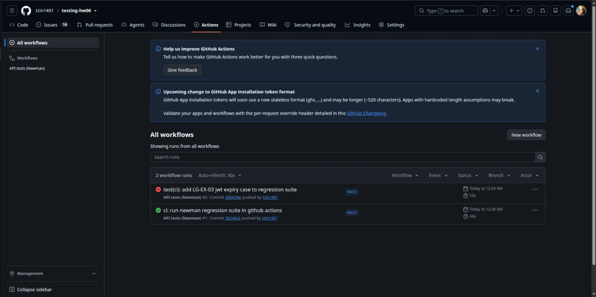
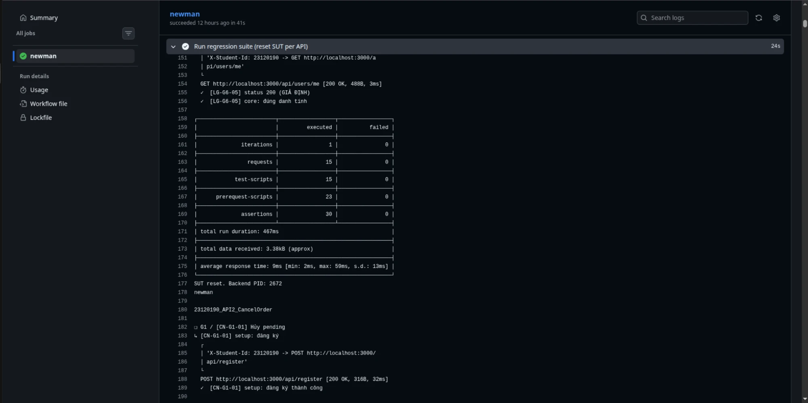
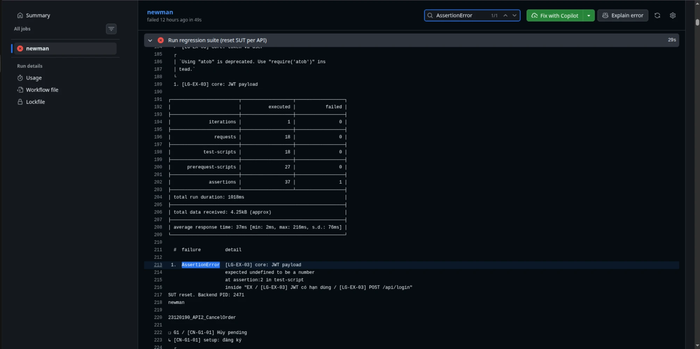
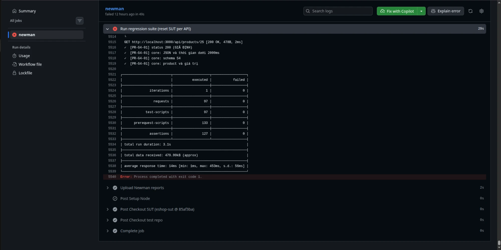

# Báo cáo CI/CD – 23120190

## 1. Cấu hình pipeline

- File: [`.github/workflows/api-tests.yml`](../.github/workflows/api-tests.yml)
- Kích hoạt: `push` lên `main`, `pull_request`, chạy tay (`workflow_dispatch`).
- Runner: `ubuntu-latest`, Node 22, timeout 15 phút.

| Bước | Việc làm |
|---|---|
| 1 | Checkout repo test |
| 2 | Checkout SUT `ttbhanh/eshop-sut` cố định commit `85af3ba` vào `eshop-sut/` |
| 3 | `npm ci` backend SUT; cài `newman@6.2.3`, `newman-reporter-htmlextra@1.23.1` |
| 4 | `scripts/run_ci.sh`: với mỗi API, `scripts/reset_sut.sh` (khởi động lại backend, seed DB) rồi `newman run` các folder case trong `ci/regression_cases.txt`, reporter `cli`, `htmlextra`, `junit` |
| 5 | Upload artifact `newman-reports` (HTML + JUnit XML + `server.log`), chạy cả khi job fail |

Mọi request vẫn mang `X-Student-Id: 23120190` qua pre-request script cấp collection; SUT chạy ở `localhost:3000` trong runner.

### Bộ regression chạy trong CI

`ci/regression_cases.txt` gồm các case **PASS hoàn toàn** trong lần chạy Newman đầy đủ ngày 2026-11-25 (`results/newman/`). Các case lộ bug được theo dõi ở GitHub Issues #1–#16, không đưa vào CI để pipeline phản ánh hồi quy chứ không lặp lại bug đã biết.

| API | Case trong CI | Request | Assertion |
|---|---|---|---|
| API1 Login | 6 | 15 | 30 |
| API2 Cancel order | 27 | 527 | 719 |
| API3 Product CRUD | 18 | 135 | 127 |
| **Tổng** | **51** | **677** | **876** |

Đã loại PR-G6-10, PR-G6-22, PR-G6-25, PR-G6-26: kết quả phụ thuộc id chẵn/lẻ được cấp khi tạo sản phẩm (BUG-16), nên không ổn định khi chạy tách riêng.

## 2. Hai lần chạy mẫu

| Commit | Nội dung | Kết quả | Link |
|---|---|---|---|
| `582e8a2` | Thêm workflow + bộ regression 51 case | ✅ success – 876/876 assertion pass | [run 45666814532](https://github.com/tzin1401/testing-hw06/actions/runs/45666814532) |
| `dbb639e` | Thêm đúng 1 case `[LG-EX-03] JWT có hạn dùng` | ❌ failure – 1 assertion fail: `[LG-EX-03] core: JWT payload` | [run 45667685029](https://github.com/tzin1401/testing-hw06/actions/runs/45667685029) |

Case fail ở commit thứ hai là bug thật **BUG-07** ([issue #7](https://github.com/tzin1401/testing-hw06/issues/7)): JWT do `/api/login` cấp không có claim `exp`. Không sửa expected để ép fail.

## 3. Ảnh chụp

**Danh sách 2 lần chạy**



**Lần chạy pass (`582e8a2`)**: bảng tổng Newman 0 fail



**Lần chạy fail (`dbb639e`)**: API1 `assertions 37 | 1`, `AssertionError [LG-EX-03] core: JWT payload – expected undefined to be a number` (payload không có `exp`)



Cuối bước Newman: `Process completed with exit code 1` → job fail



## 4. Chạy lại ở máy

```bash
scripts/run_ci.sh
```
