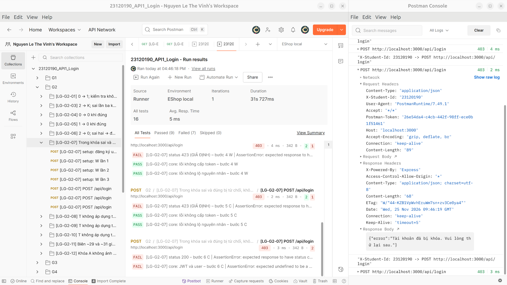

# [BUG][Login] Tài khoản bị khóa 180 giây thay vì 30 giây (BUG-02)

- **ID:** BUG-02 | **API:** `POST /api/login` | **Test case:** LG-G2-07, LG-G2-11, LG-G3-09, LG-G6-03
- **Phát hiện bởi:** AI-generated
- **Labels:** `type: bug`, `severity: major`, `priority: P1`, `module: login`, `status: new` _(severity/priority: đề xuất của AI, sinh viên review)_

## Mô tả lỗi
Tài khoản bị khóa 180 giây thay vì 30 giây. Vi phạm: README FR-02 (R:42): sai từ 3 lần liên tiếp thì tạm khóa 30 giây.

## Môi trường
- OS: Linux 7.0 (Ubuntu), Node v22.22.1
- SUT: eshop-sut commit `85af3ba`, backend `http://localhost:3000` (reset bằng `scripts/reset_sut.sh`)
- Công cụ: Postman/Newman 6.2.3, curl; header `X-Student-Id: 23120190`
- Tài khoản: user test tự đăng ký trong bước tái hiện; admin seed `admin@eshop.com`
- Ngày chạy: 2026-11-25

## Steps to reproduce
1. `scripts/reset_sut.sh` để seed lại DB.
2. Chạy `./scripts/repro_bugs.sh BUG-02` (hoặc gửi lần lượt các request trong transcript bên dưới bằng Postman/curl).
3. Đọc status và body của request cuối.

## Actual result
`locked_until` = thời điểm khóa + 180 giây. Login đúng sau 31 giây vẫn trả 403 "Tài khoản đã bị khóa".

## Expected result
Sau 30 giây, đăng nhập đúng mật khẩu thành công (200 + JWT).

Căn cứ: README FR-02 (R:42): sai từ 3 lần liên tiếp thì tạm khóa 30 giây.

## Root cause (tham khảo)
`server.js:57` đặt `Date.now() + 180000`.

## Evidence
- Newman: `results/newman/23120190_API1_Login_20261125.html` (tìm theo test case ID ở trên)
- Transcript curl thật: `evidence/issues/BUG-02_curl.txt`
- Screenshot: 

<details><summary>Transcript tái hiện (nguyên văn, JWT đã che)</summary>

```text
# BUG-02 – transcript tái hiện thật, 2026-11-25 16:29:10 +07, SUT eshop-sut@85af3ba

# FR-02: khóa 30 giây
$ scripts/reset_sut.sh   # SUT seed lại

$ curl -X POST 'http://localhost:3000/api/register' -H 'X-Student-Id: 23120190' -H 'Content-Type: application/json' -d '{"name":"Bug User","email":"bug-1795598952442827084@test.com","password":"Test1234!"}'
HTTP 200
{"message":"User registered successfully","id":3}


$ curl -X POST 'http://localhost:3000/api/login' -H 'X-Student-Id: 23120190' -H 'Content-Type: application/json' -d '{"email":"bug-1795598952442827084@test.com","password":"Test1234!"}'
HTTP 200
{"message":"Login successful","token":"eyJ***(JWT đã che)","user":{"id":3,"name":"Bug User","email":"bug-1795598952442827084@test.com","password":"Test1234!","role":"user","login_attempts":0,"locked_until":null,"reset_token":null,"shipping_address":null,"phone":null}}


$ curl -X POST 'http://localhost:3000/api/login' -H 'X-Student-Id: 23120190' -H 'Content-Type: application/json' -d '{"email":"bug-1795598952442827084@test.com","password":"Sai12345!"}'
HTTP 401
{"error":"Invalid email or password"}


$ curl -X POST 'http://localhost:3000/api/login' -H 'X-Student-Id: 23120190' -H 'Content-Type: application/json' -d '{"email":"bug-1795598952442827084@test.com","password":"Sai12345!"}'
HTTP 401
{"error":"Invalid email or password"}


$ curl -X POST 'http://localhost:3000/api/login' -H 'X-Student-Id: 23120190' -H 'Content-Type: application/json' -d '{"email":"bug-1795598952442827084@test.com","password":"Sai12345!"}'
HTTP 403
{"error":"Tài khoản đã bị khóa. Vui lòng thử lại sau."}


$ curl -X GET 'http://localhost:3000/api/users/me' -H 'X-Student-Id: 23120190' -H 'Authorization: Bearer $TOKEN_A'
HTTP 200
{"id":3,"name":"Bug User","email":"bug-1795598952442827084@test.com","password":"Test1234!","role":"user","login_attempts":4,"locked_until":"2026-11-25T09:32:12.580Z","reset_token":null,"shipping_address":null,"phone":null}

=> now=2026-11-25T09:29:12Z locked_until=2026-11-25T09:32:12.580Z

# Chờ 31 giây rồi login đúng

$ curl -X POST 'http://localhost:3000/api/login' -H 'X-Student-Id: 23120190' -H 'Content-Type: application/json' -d '{"email":"bug-1795598952442827084@test.com","password":"Test1234!"}'
HTTP 403
{"error":"Tài khoản đã bị khóa. Vui lòng thử lại sau."}
```
</details>
