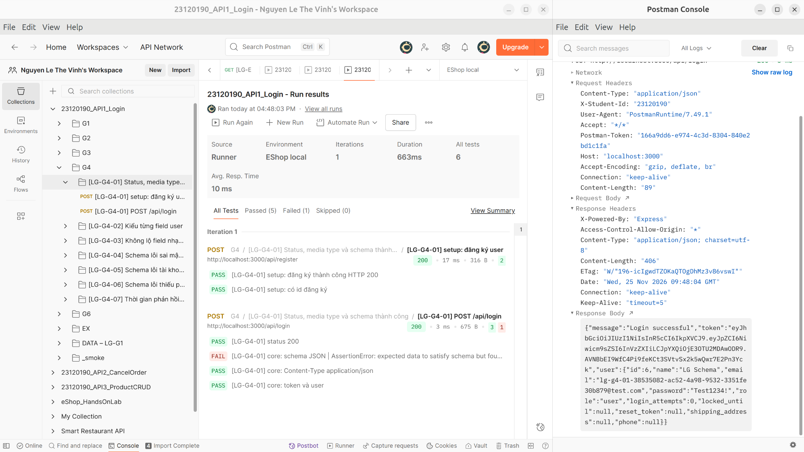

# [BUG][Login] Response login trả về mật khẩu dạng plaintext (BUG-03)

- **ID:** BUG-03 | **API:** `POST /api/login` | **Test case:** LG-G4-01, LG-G4-02, LG-G4-03, LG-G4-07
- **Phát hiện bởi:** AI-generated
- **Labels:** `type: bug`, `severity: critical`, `priority: P0`, `module: login`, `status: new` _(severity/priority: đề xuất của AI, sinh viên review)_

## Mô tả lỗi
Response login trả về mật khẩu dạng plaintext. Vi phạm: README SEC-01: mật khẩu không được lưu dạng plaintext. FR-02 chỉ yêu cầu trả JWT, không yêu cầu trả thông tin nhạy cảm.

## Môi trường
- OS: Linux 7.0 (Ubuntu), Node v22.22.1
- SUT: eshop-sut commit `85af3ba`, backend `http://localhost:3000` (reset bằng `scripts/reset_sut.sh`)
- Công cụ: Postman/Newman 6.2.3, curl; header `X-Student-Id: 23120190`
- Tài khoản: user test tự đăng ký trong bước tái hiện; admin seed `admin@eshop.com`
- Ngày chạy: 2026-11-25

## Steps to reproduce
1. `scripts/reset_sut.sh` để seed lại DB.
2. Chạy `./scripts/repro_bugs.sh BUG-03` (hoặc gửi lần lượt các request trong transcript bên dưới bằng Postman/curl).
3. Đọc status và body của request cuối.

## Actual result
`user.password` trong response là đúng mật khẩu người dùng vừa nhập (`Test1234!`). Mật khẩu được lưu và so sánh dạng plaintext.

## Expected result
Response không chứa `password` (cũng không chứa `reset_token`, `login_attempts`).

Căn cứ: README SEC-01: mật khẩu không được lưu dạng plaintext. FR-02 chỉ yêu cầu trả JWT, không yêu cầu trả thông tin nhạy cảm.

## Root cause (tham khảo)
`server.js:46` so sánh `user.password === password` (plaintext). `server.js:52` trả nguyên object `user` từ DB.

## Evidence
- Newman: `results/newman/23120190_API1_Login_20261125.html` (tìm theo test case ID ở trên)
- Transcript curl thật: `evidence/issues/BUG-03_curl.txt`
- Screenshot: 

<details><summary>Transcript tái hiện (nguyên văn, JWT đã che)</summary>

```text
# BUG-03 – transcript tái hiện thật, 2026-11-25 16:29:43 +07, SUT eshop-sut@85af3ba

# SEC-01 / không lộ dữ liệu nhạy cảm
$ scripts/reset_sut.sh   # SUT seed lại

$ curl -X POST 'http://localhost:3000/api/login' -H 'X-Student-Id: 23120190' -H 'Content-Type: application/json' -d '{"email":"test@eshop.com","password":"Test1234!"}'
HTTP 200
{"message":"Login successful","token":"eyJ***(JWT đã che)","user":{"id":2,"name":"Test User","email":"test@eshop.com","password":"Test1234!","role":"user","login_attempts":0,"locked_until":null,"reset_token":null,"shipping_address":null,"phone":null}}

=> user.password trong response = Test1234!
```
</details>
