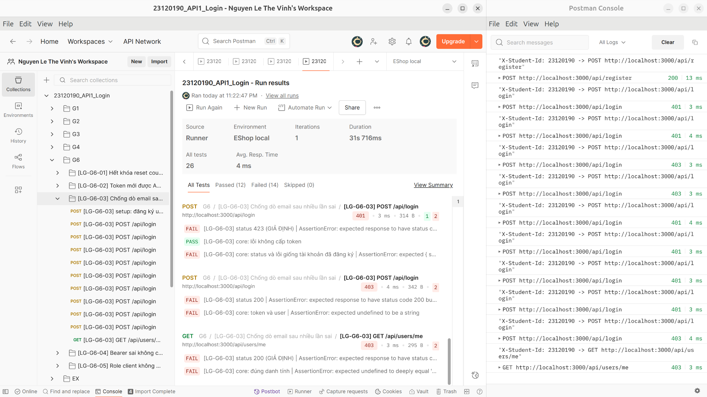

# [BUG][Login] Thông báo khóa tiết lộ email nào đã đăng ký (BUG-05)

- **ID:** BUG-05 | **API:** `POST /api/login` | **Test case:** LG-G6-03
- **Phát hiện bởi:** AI-generated
- **Labels:** `type: bug`, `severity: minor`, `priority: P3`, `module: login`, `status: new` _(severity/priority: đề xuất của AI, sinh viên review)_

## Mô tả lỗi
Thông báo khóa tiết lộ email nào đã đăng ký. Vi phạm: README FR-02 (R:42): "Hệ thống trả về thông báo lỗi phù hợp; không để lộ chi tiết nguyên nhân."

## Môi trường
- OS: Linux 7.0 (Ubuntu), Node v22.22.1
- SUT: eshop-sut commit `85af3ba`, backend `http://localhost:3000` (reset bằng `scripts/reset_sut.sh`)
- Công cụ: Postman/Newman 6.2.3, curl; header `X-Student-Id: 23120190`
- Tài khoản: user test tự đăng ký trong bước tái hiện; admin seed `admin@eshop.com`
- Ngày chạy: 2026-11-25

## Steps to reproduce
1. `scripts/reset_sut.sh` để seed lại DB.
2. Chạy `./scripts/repro_bugs.sh BUG-05` (hoặc gửi lần lượt các request trong transcript bên dưới bằng Postman/curl).
3. Đọc status và body của request cuối.

## Actual result
Email đã đăng ký (sau khi sai) nhận 403 "Tài khoản đã bị khóa". Email không tồn tại nhận 401 "Invalid email or password". Kẻ tấn công dò được email hợp lệ.

## Expected result
Cùng một input sai, email tồn tại và email không tồn tại nhận phản hồi giống nhau.

Căn cứ: README FR-02 (R:42): "Hệ thống trả về thông báo lỗi phù hợp; không để lộ chi tiết nguyên nhân."

## Root cause (tham khảo)
`server.js:37-43`: kiểm tra khóa chỉ chạy khi email tồn tại.

## Evidence
- Newman: `results/newman/23120190_API1_Login_20261125.html` (tìm theo test case ID ở trên)
- Transcript curl thật: `evidence/issues/BUG-05_curl.txt`
- Screenshot: 

<details><summary>Transcript tái hiện (nguyên văn, JWT đã che)</summary>

```text
# BUG-05 – transcript tái hiện thật, 2026-11-25 16:29:46 +07, SUT eshop-sut@85af3ba

# FR-02: không để lộ chi tiết nguyên nhân
$ scripts/reset_sut.sh   # SUT seed lại

$ curl -X POST 'http://localhost:3000/api/register' -H 'X-Student-Id: 23120190' -H 'Content-Type: application/json' -d '{"name":"Bug User","email":"bug-1795598988482011963@test.com","password":"Test1234!"}'
HTTP 200
{"message":"User registered successfully","id":3}


$ curl -X POST 'http://localhost:3000/api/login' -H 'X-Student-Id: 23120190' -H 'Content-Type: application/json' -d '{"email":"bug-1795598988482011963@test.com","password":"Test1234!"}'
HTTP 200
{"message":"Login successful","token":"eyJ***(JWT đã che)","user":{"id":3,"name":"Bug User","email":"bug-1795598988482011963@test.com","password":"Test1234!","role":"user","login_attempts":0,"locked_until":null,"reset_token":null,"shipping_address":null,"phone":null}}


$ curl -X POST 'http://localhost:3000/api/login' -H 'X-Student-Id: 23120190' -H 'Content-Type: application/json' -d '{"email":"bug-1795598988482011963@test.com","password":"Sai12345!"}'
HTTP 401
{"error":"Invalid email or password"}


$ curl -X POST 'http://localhost:3000/api/login' -H 'X-Student-Id: 23120190' -H 'Content-Type: application/json' -d '{"email":"bug-1795598988482011963@test.com","password":"Sai12345!"}'
HTTP 401
{"error":"Invalid email or password"}


# Email đã đăng ký (đang bị khóa) vs email không tồn tại, cùng password sai

$ curl -X POST 'http://localhost:3000/api/login' -H 'X-Student-Id: 23120190' -H 'Content-Type: application/json' -d '{"email":"bug-1795598988482011963@test.com","password":"Sai12345!"}'
HTTP 403
{"error":"Tài khoản đã bị khóa. Vui lòng thử lại sau."}


$ curl -X POST 'http://localhost:3000/api/login' -H 'X-Student-Id: 23120190' -H 'Content-Type: application/json' -d '{"email":"khong-ton-tai-123@test.com","password":"Sai12345!"}'
HTTP 401
{"error":"Invalid email or password"}
```
</details>
