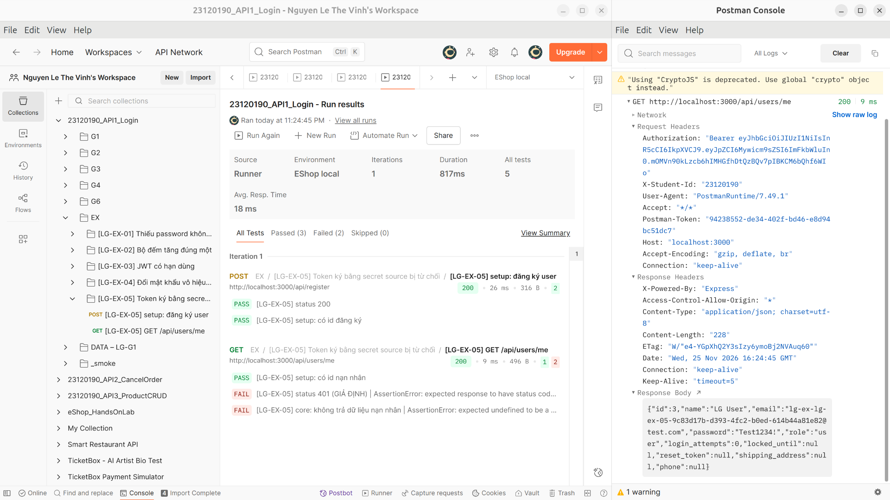

# [BUG][Auth] JWT ký bằng secret hardcode, token tự ký được chấp nhận (BUG-06)

- **ID:** BUG-06 | **API:** `POST /api/login, PUT /api/orders/:id/cancel` | **Test case:** LG-EX-05, CN-EX-05
- **Phát hiện bởi:** Human Extend (AI bỏ sót)
- **Labels:** `type: bug`, `severity: critical`, `priority: P0`, `module: auth`, `status: new`, `found-by: human-extend` _(severity/priority: đề xuất của AI, sinh viên review)_

## Mô tả lỗi
JWT ký bằng secret hardcode, token tự ký được chấp nhận. Vi phạm: README SEC-02: các API bảo mật phải yêu cầu JWT hợp lệ. FR-12: thao tác admin cần `role = 'admin'` trong token.

## Môi trường
- OS: Linux 7.0 (Ubuntu), Node v22.22.1
- SUT: eshop-sut commit `85af3ba`, backend `http://localhost:3000` (reset bằng `scripts/reset_sut.sh`)
- Công cụ: Postman/Newman 6.2.3, curl; header `X-Student-Id: 23120190`
- Tài khoản: user test tự đăng ký trong bước tái hiện; admin seed `admin@eshop.com`
- Ngày chạy: 2026-11-25

## Steps to reproduce
1. `scripts/reset_sut.sh` để seed lại DB.
2. Chạy `./scripts/repro_bugs.sh BUG-06` (hoặc gửi lần lượt các request trong transcript bên dưới bằng Postman/curl).
3. Đọc status và body của request cuối.

## Actual result
Token tự ký bằng secret đọc từ source với payload `{id:1, role:"admin"}` được chấp nhận: `GET /api/users/me` trả 200 với dữ liệu admin. Token tự ký cho user A hủy được đơn của A.

## Expected result
Token không do server cấp bị từ chối (401). Secret không nằm trong source.

Căn cứ: README SEC-02: các API bảo mật phải yêu cầu JWT hợp lệ. FR-12: thao tác admin cần `role = 'admin'` trong token.

## Root cause (tham khảo)
`server.js:9` `const SECRET_KEY = "super_secret_key_that_should_not_be_here"`.

## Evidence
- Newman: `results/newman/23120190_API1_Login_20261125.html` (tìm theo test case ID ở trên)
- Transcript curl thật: `evidence/issues/BUG-06_curl.txt`
- Screenshot: 

<details><summary>Transcript tái hiện (nguyên văn, JWT đã che)</summary>

```text
# BUG-06 – transcript tái hiện thật, 2026-11-25 16:29:48 +07, SUT eshop-sut@85af3ba

# SEC-02: token phải hợp lệ; secret hardcode trong eshop-sut/backend/server.js:9
$ scripts/reset_sut.sh   # SUT seed lại

$ curl -X POST 'http://localhost:3000/api/register' -H 'X-Student-Id: 23120190' -H 'Content-Type: application/json' -d '{"name":"Bug User","email":"bug-1795598990199014240@test.com","password":"Test1234!"}'
HTTP 200
{"message":"User registered successfully","id":3}


$ curl -X POST 'http://localhost:3000/api/login' -H 'X-Student-Id: 23120190' -H 'Content-Type: application/json' -d '{"email":"bug-1795598990199014240@test.com","password":"Test1234!"}'
HTTP 200
{"message":"Login successful","token":"eyJ***(JWT đã che)","user":{"id":3,"name":"Bug User","email":"bug-1795598990199014240@test.com","password":"Test1234!","role":"user","login_attempts":0,"locked_until":null,"reset_token":null,"shipping_address":null,"phone":null}}


$ curl -X POST 'http://localhost:3000/api/checkout' -H 'X-Student-Id: 23120190' -H 'Authorization: Bearer $TOKEN_A' -H 'Content-Type: application/json' -d '{"total_amount":100000,"shipping_address":"HCM"}'
HTTP 200
{"message":"Checkout successful","orderId":1}


# Token tự ký bằng secret lấy từ source, payload {id:1, role:admin}

$ curl -X GET 'http://localhost:3000/api/users/me' -H 'X-Student-Id: 23120190' -H 'Authorization: Bearer $FORGED'
HTTP 200
{"id":1,"name":"Admin User","email":"admin@eshop.com","password":"Admin123!","role":"admin","login_attempts":0,"locked_until":null,"reset_token":null,"shipping_address":null,"phone":null}


# Token tự ký với id của user A hủy được đơn của A

$ curl -X PUT 'http://localhost:3000/api/orders/1/cancel' -H 'X-Student-Id: 23120190' -H 'Authorization: Bearer $FORGED_A'
HTTP 200
{"message":"Order canceled successfully"}
```
</details>
