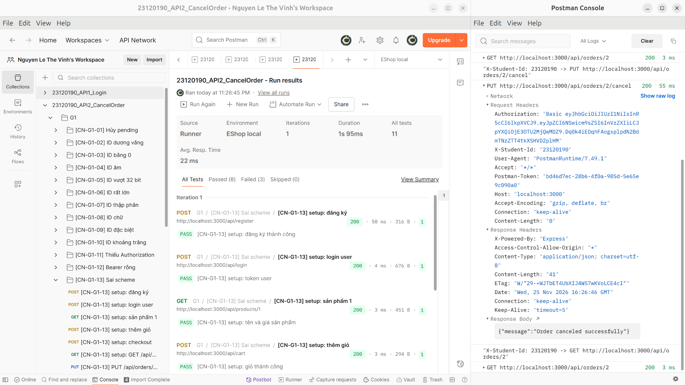

# [BUG][Auth] Header Authorization scheme Basic vẫn được chấp nhận (BUG-08)

- **ID:** BUG-08 | **API:** `PUT /api/orders/:id/cancel` | **Test case:** CN-G1-13
- **Phát hiện bởi:** AI-generated
- **Labels:** `type: bug`, `severity: minor`, `priority: P3`, `module: auth`, `status: new` _(severity/priority: đề xuất của AI, sinh viên review)_

## Mô tả lỗi
Header Authorization scheme Basic vẫn được chấp nhận. Vi phạm: README FR-02 (R:43): token gửi qua header `Authorization: Bearer <token>`.

## Môi trường
- OS: Linux 7.0 (Ubuntu), Node v22.22.1
- SUT: eshop-sut commit `85af3ba`, backend `http://localhost:3000` (reset bằng `scripts/reset_sut.sh`)
- Công cụ: Postman/Newman 6.2.3, curl; header `X-Student-Id: 23120190`
- Tài khoản: user test tự đăng ký trong bước tái hiện; admin seed `admin@eshop.com`
- Ngày chạy: 2026-11-25

## Steps to reproduce
1. `scripts/reset_sut.sh` để seed lại DB.
2. Chạy `./scripts/repro_bugs.sh BUG-08` (hoặc gửi lần lượt các request trong transcript bên dưới bằng Postman/curl).
3. Đọc status và body của request cuối.

## Actual result
`Authorization: Basic <jwt>` vẫn hủy được đơn (200, đơn chuyển `canceled`).

## Expected result
Scheme khác `Bearer` bị từ chối (401).

Căn cứ: README FR-02 (R:43): token gửi qua header `Authorization: Bearer <token>`.

## Root cause (tham khảo)
`server.js:102` lấy `split(" ")[1]` mà không kiểm tra phần đầu là `Bearer`.

## Evidence
- Newman: `results/newman/23120190_API2_CancelOrder_20261125.html` (tìm theo test case ID ở trên)
- Transcript curl thật: `evidence/issues/BUG-08_curl.txt`
- Screenshot: 

<details><summary>Transcript tái hiện (nguyên văn, JWT đã che)</summary>

```text
# BUG-08 – transcript tái hiện thật, 2026-11-25 16:30:12 +07, SUT eshop-sut@85af3ba

# Header Authorization dùng scheme Basic vẫn được chấp nhận
$ scripts/reset_sut.sh   # SUT seed lại

$ curl -X POST 'http://localhost:3000/api/register' -H 'X-Student-Id: 23120190' -H 'Content-Type: application/json' -d '{"name":"Bug User","email":"bug-1795599014389357644@test.com","password":"Test1234!"}'
HTTP 200
{"message":"User registered successfully","id":3}


$ curl -X POST 'http://localhost:3000/api/login' -H 'X-Student-Id: 23120190' -H 'Content-Type: application/json' -d '{"email":"bug-1795599014389357644@test.com","password":"Test1234!"}'
HTTP 200
{"message":"Login successful","token":"eyJ***(JWT đã che)","user":{"id":3,"name":"Bug User","email":"bug-1795599014389357644@test.com","password":"Test1234!","role":"user","login_attempts":0,"locked_until":null,"reset_token":null,"shipping_address":null,"phone":null}}


$ curl -X POST 'http://localhost:3000/api/checkout' -H 'X-Student-Id: 23120190' -H 'Authorization: Bearer $TOKEN_A' -H 'Content-Type: application/json' -d '{"total_amount":100000,"shipping_address":"HCM"}'
HTTP 200
{"message":"Checkout successful","orderId":1}


$ curl -X PUT 'http://localhost:3000/api/orders/1/cancel' -H 'X-Student-Id: 23120190' -H 'Authorization: Basic $TOKEN_A'
HTTP 200
{"message":"Order canceled successfully"}


$ curl -X GET 'http://localhost:3000/api/orders/1' -H 'X-Student-Id: 23120190'
HTTP 200
{"id":1,"user_id":3,"total_amount":100000,"status":"canceled","shipping_address":"HCM","created_at":"2026-11-25 09:30:14"}

=> status = canceled
```
</details>
