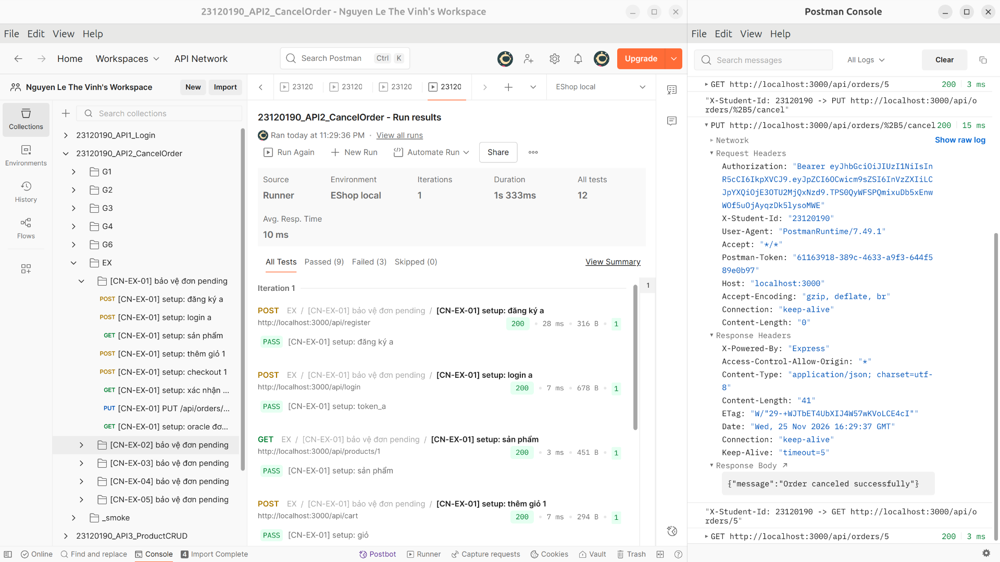

# [BUG][Order/Product] Path id dạng +1, 2.0, 03 vẫn khớp bản ghi (BUG-11)

- **ID:** BUG-11 | **API:** `PUT /api/orders/:id/cancel, DELETE/PUT /api/products/:id` | **Test case:** CN-EX-01, CN-EX-03, CN-EX-04, PR-EX-01, PR-EX-02, PR-EX-05, PR-EX-06
- **Phát hiện bởi:** Human Extend (AI bỏ sót)
- **Labels:** `type: bug`, `severity: minor`, `priority: P3`, `module: order`, `status: new`, `module: product`, `found-by: human-extend` _(severity/priority: đề xuất của AI, sinh viên review)_

## Mô tả lỗi
Path id dạng +1, 2.0, 03 vẫn khớp bản ghi. Vi phạm: Spec dùng `:id` là mã định danh của đơn/sản phẩm (A:90, A:146). Không quy định ép kiểu; nhiều chuỗi khác nhau trỏ cùng một bản ghi là hành vi không mong muốn (đề xuất: chỉ chấp nhận số nguyên dương dạng chuẩn).

## Môi trường
- OS: Linux 7.0 (Ubuntu), Node v22.22.1
- SUT: eshop-sut commit `85af3ba`, backend `http://localhost:3000` (reset bằng `scripts/reset_sut.sh`)
- Công cụ: Postman/Newman 6.2.3, curl; header `X-Student-Id: 23120190`
- Tài khoản: user test tự đăng ký trong bước tái hiện; admin seed `admin@eshop.com`
- Ngày chạy: 2026-11-25

## Steps to reproduce
1. `scripts/reset_sut.sh` để seed lại DB.
2. Chạy `./scripts/repro_bugs.sh BUG-11` (hoặc gửi lần lượt các request trong transcript bên dưới bằng Postman/curl).
3. Đọc status và body của request cuối.

## Actual result
`PUT /api/orders/%2B1/cancel`, `/2.0/cancel`, `/03/cancel` đều 200 và đơn bị hủy. `DELETE /api/products/2.0` xóa sản phẩm id 2.

## Expected result
`+1`, `2.0`, `03` bị từ chối (400 hoặc 404), dữ liệu không đổi.

Căn cứ: Spec dùng `:id` là mã định danh của đơn/sản phẩm (A:90, A:146). Không quy định ép kiểu; nhiều chuỗi khác nhau trỏ cùng một bản ghi là hành vi không mong muốn (đề xuất: chỉ chấp nhận số nguyên dương dạng chuẩn).

## Root cause (tham khảo)
`server.js:323`, `181`, `192` truyền thẳng `req.params.id` (chuỗi) vào SQLite; type affinity của cột INTEGER ép `'2.0'`, `'+1'`, `'03'` thành số.

## Evidence
- Newman: `results/newman/23120190_API2_CancelOrder_20261125.html` (tìm theo test case ID ở trên)
- Transcript curl thật: `evidence/issues/BUG-11_curl.txt`
- Screenshot: 

<details><summary>Transcript tái hiện (nguyên văn, JWT đã che)</summary>

```text
# BUG-11 – transcript tái hiện thật, 2026-11-25 16:29:57 +07, SUT eshop-sut@85af3ba

# Path id không phải số nguyên chuẩn vẫn khớp bản ghi
$ scripts/reset_sut.sh   # SUT seed lại

$ curl -X POST 'http://localhost:3000/api/register' -H 'X-Student-Id: 23120190' -H 'Content-Type: application/json' -d '{"name":"Bug User","email":"bug-1795598999127720465@test.com","password":"Test1234!"}'
HTTP 200
{"message":"User registered successfully","id":3}


$ curl -X POST 'http://localhost:3000/api/login' -H 'X-Student-Id: 23120190' -H 'Content-Type: application/json' -d '{"email":"bug-1795598999127720465@test.com","password":"Test1234!"}'
HTTP 200
{"message":"Login successful","token":"eyJ***(JWT đã che)","user":{"id":3,"name":"Bug User","email":"bug-1795598999127720465@test.com","password":"Test1234!","role":"user","login_attempts":0,"locked_until":null,"reset_token":null,"shipping_address":null,"phone":null}}


$ curl -X POST 'http://localhost:3000/api/checkout' -H 'X-Student-Id: 23120190' -H 'Authorization: Bearer $TOKEN_A' -H 'Content-Type: application/json' -d '{"total_amount":100000,"shipping_address":"HCM"}'
HTTP 200
{"message":"Checkout successful","orderId":1}


$ curl -X PUT 'http://localhost:3000/api/orders/%2B1/cancel' -H 'X-Student-Id: 23120190' -H 'Authorization: Bearer $TOKEN_A'
HTTP 200
{"message":"Order canceled successfully"}


$ curl -X GET 'http://localhost:3000/api/orders/1' -H 'X-Student-Id: 23120190'
HTTP 200
{"id":1,"user_id":3,"total_amount":100000,"status":"canceled","shipping_address":"HCM","created_at":"2026-11-25 09:29:59"}

=> order 1 status = canceled

$ curl -X POST 'http://localhost:3000/api/checkout' -H 'X-Student-Id: 23120190' -H 'Authorization: Bearer $TOKEN_A' -H 'Content-Type: application/json' -d '{"total_amount":100000,"shipping_address":"HCM"}'
HTTP 200
{"message":"Checkout successful","orderId":2}


$ curl -X PUT 'http://localhost:3000/api/orders/2.0/cancel' -H 'X-Student-Id: 23120190' -H 'Authorization: Bearer $TOKEN_A'
HTTP 200
{"message":"Order canceled successfully"}


$ curl -X GET 'http://localhost:3000/api/orders/2' -H 'X-Student-Id: 23120190'
HTTP 200
{"id":2,"user_id":3,"total_amount":100000,"status":"canceled","shipping_address":"HCM","created_at":"2026-11-25 09:29:59"}

=> order 2 status = canceled

$ curl -X POST 'http://localhost:3000/api/checkout' -H 'X-Student-Id: 23120190' -H 'Authorization: Bearer $TOKEN_A' -H 'Content-Type: application/json' -d '{"total_amount":100000,"shipping_address":"HCM"}'
HTTP 200
{"message":"Checkout successful","orderId":3}


$ curl -X PUT 'http://localhost:3000/api/orders/03/cancel' -H 'X-Student-Id: 23120190' -H 'Authorization: Bearer $TOKEN_A'
HTTP 200
{"message":"Order canceled successfully"}


$ curl -X GET 'http://localhost:3000/api/orders/3' -H 'X-Student-Id: 23120190'
HTTP 200
{"id":3,"user_id":3,"total_amount":100000,"status":"canceled","shipping_address":"HCM","created_at":"2026-11-25 09:29:59"}

=> order 3 status = canceled

# Product: DELETE /api/products/2.0 xóa product id 2

$ curl -X GET 'http://localhost:3000/api/products/2' -H 'X-Student-Id: 23120190'
HTTP 200
{"id":2,"name":"Samsung Galaxy S24 Ultra","price":"28000000","description":"Màn hình hiển thị xuất sắc, camera siêu zoom","imageUrl":"https://placehold.co/300x300/png?text=Samsung+S24","category_id":1}


$ curl -X DELETE 'http://localhost:3000/api/products/2.0' -H 'X-Student-Id: 23120190'
HTTP 200
{"message":"Product deleted"}


$ curl -X GET 'http://localhost:3000/api/products/2' -H 'X-Student-Id: 23120190'
HTTP 200
{}
```
</details>
