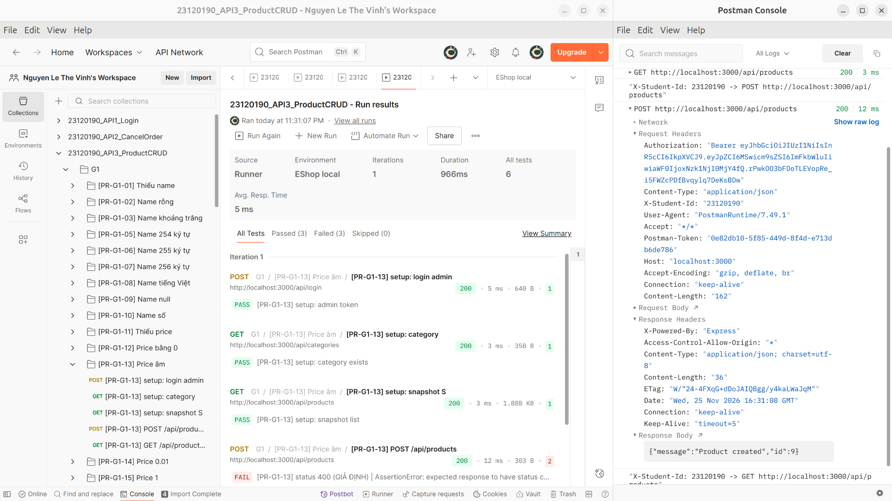

# [BUG][Product] Không validate name/price/category khi thêm và sửa sản phẩm (BUG-13)

- **ID:** BUG-13 | **API:** `POST /api/products, PUT /api/products/:id` | **Test case:** PR-G1-*, PR-G2-16, PR-G4-04, PR-G4-05, PR-G6-01..PR-G6-15, PR-EX-03, PR-EX-04
- **Phát hiện bởi:** cả hai
- **Labels:** `type: bug`, `severity: major`, `priority: P1`, `module: product`, `status: new` _(severity/priority: đề xuất của AI, sinh viên review)_

## Mô tả lỗi
Không validate name/price/category khi thêm và sửa sản phẩm. Vi phạm: README FR-15: tên bắt buộc, tối đa 255 ký tự; giá bắt buộc, số dương (> 0); danh mục bắt buộc, phải chọn từ danh sách có sẵn.

## Môi trường
- OS: Linux 7.0 (Ubuntu), Node v22.22.1
- SUT: eshop-sut commit `85af3ba`, backend `http://localhost:3000` (reset bằng `scripts/reset_sut.sh`)
- Công cụ: Postman/Newman 6.2.3, curl; header `X-Student-Id: 23120190`
- Tài khoản: user test tự đăng ký trong bước tái hiện; admin seed `admin@eshop.com`
- Ngày chạy: 2026-11-25

## Steps to reproduce
1. `scripts/reset_sut.sh` để seed lại DB.
2. Chạy `./scripts/repro_bugs.sh BUG-13` (hoặc gửi lần lượt các request trong transcript bên dưới bằng Postman/curl).
3. Đọc status và body của request cuối.

## Actual result
Thiếu name, price = -5, 0, -0, 1e309, category_id = 9999 đều trả 200 "Product created". `PUT` chỉ gửi `name` ghi đè `price`, `description`, `imageUrl`, `category_id` thành `null`.

## Expected result
Trả 400 với thông báo lỗi, không tạo hoặc sửa sản phẩm.

Căn cứ: README FR-15: tên bắt buộc, tối đa 255 ký tự; giá bắt buộc, số dương (> 0); danh mục bắt buộc, phải chọn từ danh sách có sẵn.

## Root cause (tham khảo)
`server.js:167-189` chèn/cập nhật thẳng giá trị từ body, không có validation; PUT cập nhật mọi cột kể cả cột không gửi.

## Evidence
- Newman: `results/newman/23120190_API3_ProductCRUD_20261125.html` (tìm theo test case ID ở trên)
- Transcript curl thật: `evidence/issues/BUG-13_curl.txt`
- Screenshot: 

<details><summary>Transcript tái hiện (nguyên văn, JWT đã che)</summary>

```text
# BUG-13 – transcript tái hiện thật, 2026-11-25 16:30:01 +07, SUT eshop-sut@85af3ba

# FR-15: name bắt buộc, price > 0, category từ danh sách
$ scripts/reset_sut.sh   # SUT seed lại

$ curl -X POST 'http://localhost:3000/api/products' -H 'X-Student-Id: 23120190' -H 'Content-Type: application/json' -d '{"price":100,"category_id":1}'
HTTP 200
{"message":"Product created","id":6}


$ curl -X GET 'http://localhost:3000/api/products/6' -H 'X-Student-Id: 23120190'
HTTP 200
{"id":6,"name":null,"price":"100","description":null,"imageUrl":null,"category_id":1}


$ curl -X POST 'http://localhost:3000/api/products' -H 'X-Student-Id: 23120190' -H 'Content-Type: application/json' -d '{"name":"Gia am","price":-5,"category_id":1}'
HTTP 200
{"message":"Product created","id":7}


$ curl -X GET 'http://localhost:3000/api/products/7' -H 'X-Student-Id: 23120190'
HTTP 200
{"id":7,"name":"Gia am","price":-5,"description":null,"imageUrl":null,"category_id":1}


$ curl -X POST 'http://localhost:3000/api/products' -H 'X-Student-Id: 23120190' -H 'Content-Type: application/json' -d '{"name":"Gia 0","price":0,"category_id":1}'
HTTP 200
{"message":"Product created","id":8}


$ curl -X POST 'http://localhost:3000/api/products' -H 'X-Student-Id: 23120190' -H 'Content-Type: application/json' -d '{"name":"Gia -0","price":-0,"category_id":1}'
HTTP 200
{"message":"Product created","id":9}


$ curl -X POST 'http://localhost:3000/api/products' -H 'X-Student-Id: 23120190' -H 'Content-Type: application/json' -d '{"name":"Gia vo cuc","price":1e309,"category_id":1}'
HTTP 200
{"message":"Product created","id":10}


$ curl -X POST 'http://localhost:3000/api/products' -H 'X-Student-Id: 23120190' -H 'Content-Type: application/json' -d '{"name":"Category ao","price":100,"category_id":9999}'
HTTP 200
{"message":"Product created","id":11}


# PUT thiếu field -> các field khác bị ghi NULL

$ curl -X GET 'http://localhost:3000/api/products/3' -H 'X-Student-Id: 23120190'
HTTP 200
{"id":3,"name":"MacBook Pro M3","price":45000000,"description":"Laptop chuyên nghiệp mạnh mẽ","imageUrl":"https://placehold.co/300x300/png?text=Macbook+Pro","category_id":2}


$ curl -X PUT 'http://localhost:3000/api/products/3' -H 'X-Student-Id: 23120190' -H 'Content-Type: application/json' -d '{"name":"Chi doi ten"}'
HTTP 200
{"message":"Product updated"}


$ curl -X GET 'http://localhost:3000/api/products/3' -H 'X-Student-Id: 23120190'
HTTP 200
{"id":3,"name":"Chi doi ten","price":null,"description":null,"imageUrl":null,"category_id":null}
```
</details>
