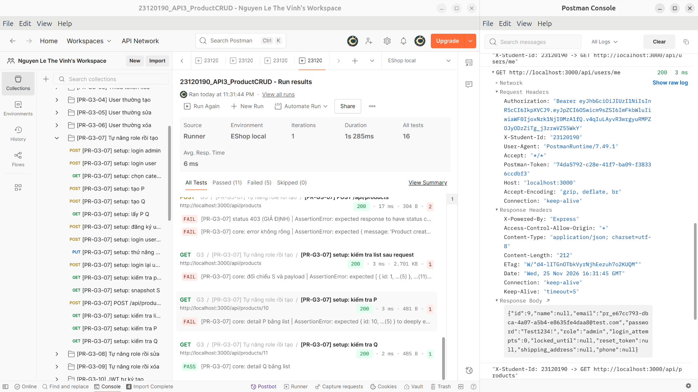

# [BUG][Profile] User thường tự nâng quyền admin qua API cập nhật hồ sơ (BUG-15)

- **ID:** BUG-15 | **API:** `PUT /api/users/me` | **Test case:** PR-G3-07, PR-G3-08, PR-G3-09
- **Phát hiện bởi:** AI-generated
- **Labels:** `type: bug`, `severity: critical`, `priority: P0`, `module: profile`, `status: new` _(severity/priority: đề xuất của AI, sinh viên review)_

## Mô tả lỗi
User thường tự nâng quyền admin qua API cập nhật hồ sơ. Vi phạm: README SEC-06: "API cập nhật hồ sơ không được cho phép thay đổi trường role từ client."

## Môi trường
- OS: Linux 7.0 (Ubuntu), Node v22.22.1
- SUT: eshop-sut commit `85af3ba`, backend `http://localhost:3000` (reset bằng `scripts/reset_sut.sh`)
- Công cụ: Postman/Newman 6.2.3, curl; header `X-Student-Id: 23120190`
- Tài khoản: user test tự đăng ký trong bước tái hiện; admin seed `admin@eshop.com`
- Ngày chạy: 2026-11-25

## Steps to reproduce
1. `scripts/reset_sut.sh` để seed lại DB.
2. Chạy `./scripts/repro_bugs.sh BUG-15` (hoặc gửi lần lượt các request trong transcript bên dưới bằng Postman/curl).
3. Đọc status và body của request cuối.

## Actual result
`PUT /api/users/me` với `{"role":"admin"}` trả 200. `GET /api/users/me` và lần login sau đều trả `role: admin`.

## Expected result
Trường `role` bị bỏ qua hoặc bị từ chối; role giữ `user`.

Căn cứ: README SEC-06: "API cập nhật hồ sơ không được cho phép thay đổi trường role từ client."

## Root cause (tham khảo)
`server.js:118-128` thêm `role = ?` vào câu UPDATE khi body có `role`.

## Evidence
- Newman: `results/newman/23120190_API3_ProductCRUD_20261125.html` (tìm theo test case ID ở trên)
- Transcript curl thật: `evidence/issues/BUG-15_curl.txt`
- Screenshot: 

<details><summary>Transcript tái hiện (nguyên văn, JWT đã che)</summary>

```text
# BUG-15 – transcript tái hiện thật, 2026-11-25 16:30:04 +07, SUT eshop-sut@85af3ba

# SEC-06: API cập nhật hồ sơ không được đổi role
$ scripts/reset_sut.sh   # SUT seed lại

$ curl -X POST 'http://localhost:3000/api/register' -H 'X-Student-Id: 23120190' -H 'Content-Type: application/json' -d '{"name":"Bug User","email":"bug-1795599006137333491@test.com","password":"Test1234!"}'
HTTP 200
{"message":"User registered successfully","id":3}


$ curl -X POST 'http://localhost:3000/api/login' -H 'X-Student-Id: 23120190' -H 'Content-Type: application/json' -d '{"email":"bug-1795599006137333491@test.com","password":"Test1234!"}'
HTTP 200
{"message":"Login successful","token":"eyJ***(JWT đã che)","user":{"id":3,"name":"Bug User","email":"bug-1795599006137333491@test.com","password":"Test1234!","role":"user","login_attempts":0,"locked_until":null,"reset_token":null,"shipping_address":null,"phone":null}}


$ curl -X PUT 'http://localhost:3000/api/users/me' -H 'X-Student-Id: 23120190' -H 'Authorization: Bearer $TOKEN_A' -H 'Content-Type: application/json' -d '{"name":"Bug User","role":"admin"}'
HTTP 200
{"message":"Profile updated"}


$ curl -X GET 'http://localhost:3000/api/users/me' -H 'X-Student-Id: 23120190' -H 'Authorization: Bearer $TOKEN_A'
HTTP 200
{"id":3,"name":"Bug User","email":"bug-1795599006137333491@test.com","password":"Test1234!","role":"admin","login_attempts":0,"locked_until":null,"reset_token":null,"shipping_address":null,"phone":null}

=> role = admin

$ curl -X POST 'http://localhost:3000/api/login' -H 'X-Student-Id: 23120190' -H 'Content-Type: application/json' -d '{"email":"bug-1795599006137333491@test.com","password":"Test1234!"}'
HTTP 200
{"message":"Login successful","token":"eyJ***(JWT đã che)","user":{"id":3,"name":"Bug User","email":"bug-1795599006137333491@test.com","password":"Test1234!","role":"admin","login_attempts":0,"locked_until":null,"reset_token":null,"shipping_address":null,"phone":null}}

=> role trong login = admin
```
</details>
